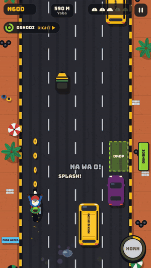

<p align="center">
  <a href="https://okada-rush.vercel.app"></a>
</p>

<p align="center">
  <a href="https://okada-rush.vercel.app"></a>
  
  
</p>

<h3 align="center">Oga, Oshodi! Abeg quick!</h3>

<p align="center">
  You're an okada rider in Lagos. Passengers are waving from the roadside, the danfo in front of you just switched lanes without warning, and a goat has decided today is the day it crosses the road.<br>
  <b>Pick them up. Beat the traffic. Drop them at the right bus stop before they waka.</b>
</p>

<p align="center">
  
</p>

---

## How it plays

One thumb is all you need. Rides are short, so it's perfect for a bus queue, a lunch break, or "just one more go".

| | Phone | Keyboard |
| --- | --- | --- |
| **Steer** | Drag anywhere | ← → or A / D |
| **Gas** (hold to speed up) | Hold **GAS** | ↑ or W |
| **Brake** | | ↓ or S |
| **Horn** (clears your lane, scares goats) | Tap **HORN** | Space |
| **Pause** | Pause button | P or Esc |

**The hustle, in four steps**

1. **Spot a passenger.** They wave from the curb with their bus stop above their head: Ojuelegba, CMS, Oshodi or Obalende.
2. **Ride along the curb** to pick them up. Their timer starts ticking.
3. **Find the stop with their colour** and ride through its zone. Faster drops mean bigger tips, so hold the gas when the road is clear. Drops in a row build a combo.
4. **Don't crash.** Danfos, cars, kekes, BRT buses and goats all want your 3 helmets. Potholes won't take a helmet, but they will slow you down.

**Things worth grabbing**

| Pick-up | What it does |
| --- | --- |
| **Puff-puff** | Gives you back a helmet |
| **Hot pepper** | Turbo. You're untouchable for a few seconds and smash straight through traffic |
| **Magnet** | Pulls every naira coin nearby into your pocket |

## Why you'll come back tomorrow

- **The Garage.** Every naira you earn is saved. Spend it on an extra helmet, a louder horn, Sweet Talk (bigger tips) and the Back Seat, which lets you carry two passengers at once. Then pick a new ride from six bikes, from Bajaj Red to *Oga at the Top*.
- **Daily missions.** Three new jobs every midnight, plus a bonus for clearing all three.
- **The Daily Route.** Every rider gets the same road each day. Keep your streak alive for bigger rewards, and share your result as a little Wordle-style grid: 🟩 for a drop, 🟥 for a crash.

## Made of Lagos

The details are the point:

- Danfos carry their real roof slogans: *No Condition Is Permanent*, *God Dey*, *No Food For Lazy Man*.
- The roadside is lined with Mama Put spots, POS stands, vulcanizers, suya and pure water sellers.
- The curbs are painted yellow and black, and green road signs welcome you as you ride from Yaba into Surulere, Ikeja, Lekki and Victoria Island.
- Passengers talk back in pidgin: *"I dey late o!"* when you pick them up, *"Correct rider!"* when you deliver, and *"I don waka!"* if you're too slow.

## What's next

| Phase | What ships |
| --- | --- |
| **Now: playable demo** | One Lagos route, passengers and stops, the Garage, daily missions, the Daily Route |
| **Next: daily rivals** | A Daily Route leaderboard, racing a ghost of the day's best ride, weekly events |
| **Then: deeper Lagos** | Rain and night rides, a Third Mainland Bridge stage, traffic-jam events, more passenger types |
| **Later: the Rush series** | The same loop in new cities with their own rides (Accra, Nairobi, Manila, Bangkok), plus phone app stores |

## Under the hood

- **One file.** The whole game is a single `index.html`: HTML, CSS and vanilla JavaScript on Canvas 2D, with no framework, no build step and no dependencies.
- **No art files.** Every danfo, keke, goat, palm tree and umbrella stall is drawn in code.
- **No audio files.** The Afrobeat-style music loop and every sound effect, from the horn to the "ka-ching", is synthesized live with the Web Audio API.
- **Progress stays on your device**, saved in your browser.
- `og.png` and `gameplay.gif` are only for link previews and this page.

Want to run it yourself? Open `index.html` in any browser, or:

```bash
npx serve .
```

## Credits

Made by [0xNexuz](https://github.com/0xNexuz) with AI, for the [Loadout AI Game Competition](https://app.loadout.xyz/jam).
